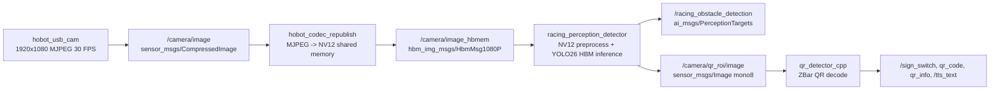

# racing_perception_detector 设计说明

本文档描述目标 ROS2 包 `racing_perception_detector` 的职责、输入输出、参数、推理流程、YOLO26 后处理、二维码 ROI 发布策略和推荐代码结构。目标是按本文档可以直接开始实现包：

```text
dev_ws/src/perception/racing_perception_detector
```

## 1. 包职责

`racing_perception_detector` 是比赛感知检测节点，负责从相机 NV12 图像中运行 S100 BPU YOLO26 检测模型，输出障碍物/标志牌检测结果，并从停车牌或二维码提示牌检测框中裁剪二维码 ROI，发布给 `qr_detector_cpp` 做 ZBar 解码。

它不负责二维码内容识别。二维码识别仍由 `qr_detector_cpp` 完成，`qr_detector_cpp` 只订阅：

```text
/camera/qr_roi/image
```

设计目标：

- 使用 RDK S100 `.hbm` 模型，不再使用 RDK X5 `.bin` 模型。
- 使用 YOLO26 Detect 的 C++ runtime 逻辑。
- 从 `/camera/image_hbmem` 接收 NV12 shared memory 图像。
- 对全图做 BPU 目标检测。
- 只对检测出的二维码相关目标裁剪 ROI，不做全图 ZBar 扫描。
- 发布 `mono8` ROI 图像，供 QR 节点高帧率扫描。
- 保持旧 topic `/racing_obstacle_detection` 作为检测结果输出，减少下游改动。

## 2. 总体 Pipeline



## 3. 推荐包结构

```text
racing_perception_detector/
├── CMakeLists.txt
├── package.xml
├── include/racing_perception_detector/
│   ├── detector_types.hpp
│   ├── nv12_utils.hpp
│   ├── qr_roi_publisher.hpp
│   └── yolo26_detector.hpp
├── src/
│   ├── racing_perception_detector_node.cpp
│   ├── nv12_utils.cpp
│   ├── qr_roi_publisher.cpp
│   └── yolo26_detector.cpp
└── launch/
    └── racing_perception_detector.launch.py
```

配置文件放在工作空间统一配置目录：

```text
dev_ws/config/perception/racing_perception_detector.yaml
```

不要把参数放进包内 `config/`，这样和已有 `qr_detector.yaml` 保持一致。

## 4. 输入 Topic

### 4.1 主输入图像

| 项 | 值 |
| --- | --- |
| Topic | `/camera/image_hbmem` |
| Type | `hbm_img_msgs/msg/HbmMsg1080P` |
| 数据格式 | NV12 shared memory / NV12 bytes |
| 默认分辨率 | 1920x1080 |
| 帧率目标 | 30 FPS |
| QoS | `rclcpp::SensorDataQoS().keep_last(1).best_effort()` |
| 用途 | YOLO26 全图检测，裁剪 QR ROI |

注意：旧 demo 使用 `/hbmem_img`，新包默认应改为 `/camera/image_hbmem`，与当前 `camera_driver.yaml` 中 `usb_cam_nv12_codec_node.pub_topic` 保持一致。

如果 `HbmMsg1080P` 消息没有可靠的 `width/height` 字段，则节点通过参数指定源图像大小：

```yaml
source_width: 1920
source_height: 1080
```

### 4.2 不建议订阅的输入

| Topic | 原因 |
| --- | --- |
| `/camera/image` | MJPEG/CompressedImage，需要 CPU 解码，不适合作为 BPU 检测主输入 |
| `/camera/image_compressed` | 用于远程预览，不用于实时检测 |
| `/camera/qr_roi/image` | 这是本节点输出给 QR 检测器的 ROI，不是本节点输入 |

## 5. 输出 Topic

### 5.1 检测结果

| 项 | 值 |
| --- | --- |
| Topic | `/racing_obstacle_detection` |
| Type | `ai_msgs/msg/PerceptionTargets` |
| QoS | `keep_last(1)` 或 `SensorDataQoS().keep_last(1)` |
| 坐标系 | 原始相机图像坐标，默认 1920x1080 |
| 用途 | 下游避障、状态判断、调试 |

推荐消息填充：

```cpp
ai_msgs::msg::PerceptionTargets msg;
msg.header.stamp = input_stamp;
msg.header.frame_id = camera_frame_id;  // 默认 "usb_cam"

ai_msgs::msg::Target target;
target.type = class_name;               // "construction_cone" / "parking_sign"
target.track_id = 0;                    // 未做跟踪时固定 0

ai_msgs::msg::Roi roi;
roi.type = "rect";
roi.rect.x_offset = x;
roi.rect.y_offset = y;
roi.rect.width = width;
roi.rect.height = height;
roi.rect.do_rectify = false;
roi.confidence = score;

target.rois.push_back(roi);
msg.targets.push_back(target);
```

检测框必须是原始图像坐标，不是模型输入 640x640 坐标。后处理必须完成 letterbox 逆变换和边界裁剪。

### 5.2 二维码 ROI 图像

| 项 | 值 |
| --- | --- |
| Topic | `/camera/qr_roi/image` |
| Type | `sensor_msgs/msg/Image` |
| Encoding | `mono8` |
| QoS | `rclcpp::SensorDataQoS().keep_last(1).best_effort()` |
| 发布条件 | 检测到 `parking_sign` 或指定 QR 类别 |
| 用途 | 给 `qr_detector_cpp` 做 ZBar 扫描 |

推荐消息填充：

```cpp
sensor_msgs::msg::Image roi_msg;
roi_msg.header.stamp = input_stamp;
roi_msg.header.frame_id = camera_frame_id;
roi_msg.height = roi_h;
roi_msg.width = roi_w;
roi_msg.encoding = sensor_msgs::image_encodings::MONO8;
roi_msg.is_bigendian = false;
roi_msg.step = roi_w;
roi_msg.data.resize(roi_w * roi_h);
```

ROI 图像直接从原始 NV12 的 Y 平面裁剪，因此天然是灰度 `mono8`。不需要把整帧 NV12 转 BGR，也不需要转 JPEG。

### 5.3 可选调试输出

默认不要开启调试图像。需要排查时可通过参数开启：

| Topic | Type | 默认 | 用途 |
| --- | --- | --- | --- |
| `/racing_perception_detector/debug_image` | `sensor_msgs/msg/Image` 或 `sensor_msgs/msg/CompressedImage` | 关闭 | 绘制检测框后的预览 |
| `/racing_perception_detector/status` | `diagnostic_msgs/msg/DiagnosticArray` 或日志 | 关闭 | 推理耗时、丢帧、模型状态 |

比赛运行时不建议发布 debug 图像，否则会增加 CPU 和总线负载。

## 6. 参数设计

推荐配置文件：

```yaml
racing_perception_detector_node:
  ros__parameters:
    # ROS topics
    input_topic: /camera/image_hbmem
    detection_topic: /racing_obstacle_detection
    qr_roi_topic: /camera/qr_roi/image
    camera_frame_id: usb_cam

    # Source image. HbmMsg1080P normally means 1920x1080.
    source_width: 1920
    source_height: 1080

    # Model
    model_path: /root/D_Robot/dev_ws/models/yolo26_detect_nashe_640x640_nv12.hbm
    model_input_width: 640
    model_input_height: 640
    preprocess_type: letterbox       # letterbox or resize
    class_num: 2
    class_names:
      - construction_cone
      - parking_sign

    # Postprocess
    score_threshold: 0.25
    nms_threshold: 0.45
    nms_top_k: 300
    strides: [8, 16, 32]

    # QR ROI
    qr_class_name: parking_sign
    qr_class_id: 1
    qr_roi_margin_ratio: 0.25
    qr_roi_min_width: 16
    qr_roi_min_height: 16
    publish_qr_roi_without_detection: false
    choose_qr_roi_policy: highest_score  # highest_score or largest_area

    # Runtime
    qos_keep_last: 1
    bpu_core: any                    # any, core0, core1, core2...
    log_timing: true
    log_fps: true
    debug_image: false
```

`model_input_width/height` 可以从 HBM 输入 tensor 自动读取。参数存在的意义是启动时做一致性检查，发现模型和配置不一致时直接报错。

## 7. 模型要求

目标模型来自 `rdk_model_zoo_s` 的 YOLO26 detect S100 runtime 方案。

参考分支：

```text
https://github.com/JasperXzy/rdk_model_zoo_s/tree/feat/yolo26-detect-cpp-runtime
```

本地下载到的分支 zip 注释显示 commit：

```text
4afa9f0387644475b626267d69916bff0f7b2544
```

### 7.1 导出 ONNX

YOLO26 Detect 需要使用 BPU 适配导出脚本：

```text
samples/Vision/yolo26/conversion/onnx_export/export_yolo26_detect_bpu.py
```

该脚本会 monkey patch `Detect.forward`，把输出改成 BPU 友好的 6 个 NHWC tensor：

```text
[Box_8, Cls_8, Box_16, Cls_16, Box_32, Cls_32]
```

其中：

- `Box_*` 是 4 通道，表示 `[l, t, r, b]`。
- `Cls_*` 是 `class_num` 通道，表示每个类别的 raw logits。
- 不再是 YOLOv8/YOLO11 的 DFL `4 * reg = 64` 分布输出。

### 7.2 编译 HBM

RDK S100 使用 Nash-E 架构：

```bash
python3 mapper.py --onnx yolo26_detect_bpu.onnx --cal-images ./cal_images --march nash-e
```

关键编译配置：

```yaml
input_type_rt: nv12
input_type_train: rgb
input_layout_train: NCHW
norm_type: data_scale
scale_value: 0.003921568627451
compiler_parameters:
  extra_params: {'input_no_padding': True, 'output_no_padding': True}
```

### 7.3 模型信息检查

上板后必须先检查：

```bash
hrt_model_exec model_info --model_file /path/to/model.hbm
```

期望输入：

```text
input_count = 2
input[0] = Y plane,  shape ~= (1, 640, 640, 1)
input[1] = UV plane, shape ~= (1, 320, 320, 2)
```

期望输出，假设 `class_num=2`、输入 640x640：

```text
output_count = 6
Box_8   shape ~= (1, 80, 80, 4)
Cls_8   shape ~= (1, 80, 80, 2)
Box_16  shape ~= (1, 40, 40, 4)
Cls_16  shape ~= (1, 40, 40, 2)
Box_32  shape ~= (1, 20, 20, 4)
Cls_32  shape ~= (1, 20, 20, 2)
```

如果输出不是 float，需要在 C++ 中按 `hbDNNTensorProperties.quantiType` 和 `scale` 做反量化。`rdk_model_zoo_s` 的示例直接把输出读成 `float*`，实现前必须确认你的 `.hbm` 是否符合这个假设。

## 8. S100 DNN/UCP Runtime

头文件：

```cpp
#include "hobot/dnn/hb_dnn.h"
#include "hobot/hb_ucp.h"
#include "hobot/hb_ucp_sys.h"
```

核心类型：

```cpp
hbDNNPackedHandle_t packed_handle;
hbDNNHandle_t dnn_handle;
hbDNNTensor input_tensors[input_count];
hbDNNTensor output_tensors[output_count];
hbUCPTaskHandle_t task;
```

模型加载：

```cpp
const char* model_fn = model_path.c_str();
hbDNNInitializeFromFiles(&packed_handle, &model_fn, 1);
hbDNNGetModelNameList(&model_names, &model_count, packed_handle);
hbDNNGetModelHandle(&dnn_handle, packed_handle, model_names[0]);
```

推理：

```cpp
hbDNNInferV2(&task, outputs.data(), inputs.data(), dnn_handle);

hbUCPSchedParam param;
HB_UCP_INITIALIZE_SCHED_PARAM(&param);
param.backend = HB_UCP_BPU_CORE_ANY;

hbUCPSubmitTask(task, &param);
hbUCPWaitTaskDone(task, 0);
hbUCPReleaseTask(task);
```

内存：

```cpp
hbUCPMallocCached(&tensor.sysMem, byte_size, 0);
hbUCPMemFlush(&tensor.sysMem, HB_SYS_MEM_CACHE_CLEAN);       // input before infer
hbUCPMemFlush(&tensor.sysMem, HB_SYS_MEM_CACHE_INVALIDATE);  // output after infer
hbUCPFree(&tensor.sysMem);
```

链接库参考：

```cmake
target_link_libraries(racing_perception_detector_node
  ${OpenCV_LIBS}
  dnn
  hbucp
  pthread
  rt
  dl
  m
)
```

如果板端库名不是 `hbucp`，检查：

```bash
ls /usr/hobot/lib | grep -E 'ucp|dnn'
```

## 9. 初始化流程

节点启动时执行：

1. `declare_parameter()` 声明所有参数。
2. 读取 `model_path`、topic、类别、阈值、源图大小。
3. 加载 HBM：
   - `hbDNNInitializeFromFiles`
   - `hbDNNGetModelNameList`
   - `hbDNNGetModelHandle`
4. 读取输入数量和输入 tensor 属性：
   - 要求 2 输入，分别为 Y 和 UV。
   - 读取或校验模型输入宽高。
5. 读取输出数量和输出 tensor 属性：
   - 要求 6 输出。
   - 按 shape 推断输出顺序。
6. 预分配输入和输出 `hbDNNTensor` 内存。
7. 创建 publisher：
   - `/racing_obstacle_detection`
   - `/camera/qr_roi/image`
   - 可选 debug/status
8. 创建 subscriber：
   - `/camera/image_hbmem`

初始化阶段要 fail fast。模型输出数量、输入数量、类别数、shape 不符合预期时，不应继续运行。

## 10. 每帧推理流程

### 10.1 接收图像

回调接收：

```cpp
void imageCallback(const hbm_img_msgs::msg::HbmMsg1080P::SharedPtr msg)
```

从消息中取：

- NV12 数据指针。
- 时间戳，优先使用 `msg->time_stamp`。
- 源宽高，优先使用参数 `source_width/source_height`。

若源数据大小小于：

```text
source_width * source_height * 3 / 2
```

则丢弃该帧并 throttle log。

### 10.2 NV12 Letterbox

生产路径不要把整帧转 BGR。直接对 NV12 的 Y/UV 平面做 resize + padding：

```cpp
letterboxNv12(
  src_nv12,
  source_width,
  source_height,
  dst_nv12,
  model_input_width,
  model_input_height,
  x_shift,
  y_shift,
  x_scale,
  y_scale
);
```

其中：

```text
x_scale = y_scale = min(model_h / source_h, model_w / source_w)
new_w = source_w * x_scale
new_h = source_h * y_scale
x_shift = (model_w - new_w) / 2
y_shift = (model_h - new_h) / 2
```

Y 平面 padding 值用 127。UV 平面 padding 用 `(127, 127)`。

### 10.3 填充模型输入

YOLO26 S100 HBM 通常是两个输入：

```text
input[0] = Y plane
input[1] = UV plane
```

Y 输入：

```cpp
byte_size = input_h * input_w;
shape = (1, input_h, input_w, 1);
stride = [input_h * input_w, input_w, 1, 1];
memcpy(input[0].sysMem.virAddr, nv12.data, byte_size);
hbUCPMemFlush(&input[0].sysMem, HB_SYS_MEM_CACHE_CLEAN);
```

UV 输入：

```cpp
uv_h = input_h / 2;
uv_w = input_w / 2;
byte_size = uv_h * uv_w * 2;
shape = (1, uv_h, uv_w, 2);
stride = [uv_h * uv_w * 2, uv_w * 2, 2, 1];
memcpy(input[1].sysMem.virAddr, nv12.data + input_h * input_w, byte_size);
hbUCPMemFlush(&input[1].sysMem, HB_SYS_MEM_CACHE_CLEAN);
```

注意：shape 和 stride 的维度顺序按 `hbDNNTensorProperties.validShape.dimensionSize` 实际模型为准。示例 runtime 使用 NHWC 风格设置。

### 10.4 执行 BPU 推理

```cpp
hbUCPTaskHandle_t task = nullptr;
hbDNNInferV2(&task, outputs.data(), inputs.data(), dnn_handle);
hbUCPSubmitTask(task, &sched_param);
hbUCPWaitTaskDone(task, 0);
```

建议记录耗时：

- preprocess time
- infer time
- postprocess time
- total callback time
- input FPS
- published detection FPS
- published QR ROI FPS

### 10.5 输出缓存刷新

推理完成后，每个输出都要：

```cpp
hbUCPMemFlush(&outputs[i].sysMem, HB_SYS_MEM_CACHE_INVALIDATE);
```

否则 CPU 读到的可能是旧缓存。

## 11. YOLO26 后处理

### 11.1 输出顺序识别

不要假设模型输出天然就是固定顺序。启动时或每帧前按 shape 建立映射：

```text
order[0] = Box_8
order[1] = Cls_8
order[2] = Box_16
order[3] = Cls_16
order[4] = Box_32
order[5] = Cls_32
```

对 640x640、2 类模型：

```cpp
if (h == 80 && w == 80 && c == 4) order[0] = i;
if (h == 80 && w == 80 && c == 2) order[1] = i;
if (h == 40 && w == 40 && c == 4) order[2] = i;
if (h == 40 && w == 40 && c == 2) order[3] = i;
if (h == 20 && w == 20 && c == 4) order[4] = i;
if (h == 20 && w == 20 && c == 2) order[5] = i;
```

`class_num` 不要硬编码为 80，要从参数读取。

### 11.2 Raw logit 阈值优化

类别输出是 sigmoid 前的 raw logit。可以先把 score 阈值换算到 logit 空间，减少 sigmoid 计算：

```cpp
float calcLogitThreshold(float score_threshold) {
  float t = std::max(1e-6f, std::min(score_threshold, 1.0f - 1e-6f));
  return -std::log(1.0f / t - 1.0f);
}
```

筛选：

```cpp
if (cur_cls[max_id] < conf_thres_raw) {
  continue;
}
```

再计算真实 score：

```cpp
score = sigmoid(cur_cls[max_id]);
```

### 11.3 Box decode

YOLO26 box 输出是 `[l, t, r, b]`，不是 DFL。

对每个 stride 的 feature map：

```cpp
float* box_ptr = static_cast<float*>(outputs[box_idx].sysMem.virAddr);
float* cls_ptr = static_cast<float*>(outputs[cls_idx].sysMem.virAddr);

for (int i = 0; i < h; ++i) {
  for (int j = 0; j < w; ++j) {
    int offset = i * w + j;
    float* cur_cls = cls_ptr + offset * class_num;
    float* cur_box = box_ptr + offset * 4;

    float l = cur_box[0];
    float t = cur_box[1];
    float r = cur_box[2];
    float b = cur_box[3];

    float cx = j + 0.5f;
    float cy = i + 0.5f;

    float x1 = (cx - l) * stride;
    float y1 = (cy - t) * stride;
    float x2 = (cx + r) * stride;
    float y2 = (cy + b) * stride;
  }
}
```

丢弃非法框：

```cpp
if (x2 <= x1 || y2 <= y1) continue;
```

### 11.4 NMS

按类别分别 NMS：

```cpp
std::vector<std::vector<cv::Rect2d>> bboxes(class_num);
std::vector<std::vector<float>> scores(class_num);

for (int c = 0; c < class_num; ++c) {
  std::vector<int> indices;
  cv::dnn::NMSBoxes(
    bboxes[c],
    scores[c],
    score_threshold,
    nms_threshold,
    indices,
    1.0f,
    nms_top_k
  );
}
```

### 11.5 坐标还原到原图

模型输出坐标在 letterbox 后的 640x640 空间。发布前还原到原图：

```cpp
float x1_orig = (x1_model - x_shift) / x_scale;
float y1_orig = (y1_model - y_shift) / y_scale;
float x2_orig = (x2_model - x_shift) / x_scale;
float y2_orig = (y2_model - y_shift) / y_scale;
```

然后裁剪：

```cpp
x1_orig = clamp(x1_orig, 0, source_width);
y1_orig = clamp(y1_orig, 0, source_height);
x2_orig = clamp(x2_orig, 0, source_width);
y2_orig = clamp(y2_orig, 0, source_height);
```

发布 `x/y/width/height`：

```cpp
x = round(x1_orig);
y = round(y1_orig);
width = round(x2_orig - x1_orig);
height = round(y2_orig - y1_orig);
```

## 12. QR ROI 生成

### 12.1 选择检测框

默认使用：

```yaml
qr_class_name: parking_sign
qr_class_id: 1
choose_qr_roi_policy: highest_score
```

策略：

1. 从 NMS 后 detections 中筛选 `class_id == qr_class_id`。
2. 如果没有，当前帧不发布 `/camera/qr_roi/image`。
3. 如果有多个：
   - `highest_score`：选择置信度最高的框。
   - `largest_area`：选择面积最大的框。

不建议发布多个 ROI topic。ZBar 节点保持简单，只处理最新 ROI。

### 12.2 扩边

假设检测框：

```text
x, y, w, h
```

扩边比例：

```text
margin = 0.25
```

计算：

```cpp
int dx = round(w * margin);
int dy = round(h * margin);

roi_x1 = clamp(x - dx, 0, source_width);
roi_y1 = clamp(y - dy, 0, source_height);
roi_x2 = clamp(x + w + dx, 0, source_width);
roi_y2 = clamp(y + h + dy, 0, source_height);
```

如果 ROI 小于最小尺寸：

```yaml
qr_roi_min_width: 16
qr_roi_min_height: 16
```

则不发布，避免给 QR 节点发送无意义图像。

### 12.3 从 NV12 裁剪 mono8

NV12 的 Y 平面在最前面：

```cpp
const uint8_t* y_plane = nv12_data;
```

裁剪 ROI：

```cpp
for (int row = 0; row < roi_h; ++row) {
  const uint8_t* src = y_plane + (roi_y + row) * source_width + roi_x;
  uint8_t* dst = roi_msg.data.data() + row * roi_w;
  memcpy(dst, src, roi_w);
}
```

这样输出就是 `mono8`，不会产生颜色转换成本。

### 12.4 ROI 时间戳

`roi_msg.header.stamp` 必须使用输入图像时间戳，不要用当前系统时间：

```cpp
roi_msg.header.stamp = input_stamp;
roi_msg.header.frame_id = camera_frame_id;
```

这样后续如果要做同步或调试，可以追踪 ROI 来自哪一帧。

## 13. 性能要求与实现约束

目标是 1920x1080 输入下达到 30 FPS，单帧总耗时应小于 33 ms。

关键约束：

- Subscriber QoS 使用 `keep_last(1)`，防止处理不过来时堆积旧帧。
- 不做全图 QR 扫描。
- 不做全图 BGR 转换。
- 不做 JPEG 编码。
- 不在回调里频繁 `hbUCPMallocCached/hbUCPFree`。
- 输入输出 tensor 内存应在初始化时分配并复用。
- `std::vector` 容器可 `reserve()`，每帧 `clear()`。
- 日志使用 throttle，FPS 每秒打印一次即可。
- Debug image 默认关闭。
- 若处理时间超过 33 ms，优先优化 NV12 resize 和后处理，而不是降低 QR 准确率。

推荐每帧记录：

```text
preprocess_ms
infer_ms
postprocess_ms
publish_ms
total_ms
input_fps
roi_publish_fps
```

## 14. 与旧 racing_obstacle_detection 的差异

| 项 | 旧包 | 新包 |
| --- | --- | --- |
| 包名 | `racing_obstacle_detection` | `racing_perception_detector` |
| 目标平台 | RDK X5 / Bayes | RDK S100 / Nash-E |
| 模型格式 | `.bin` | `.hbm` |
| DNN 头文件 | `dnn/hb_dnn.h`, `dnn/hb_sys.h` | `hobot/dnn/hb_dnn.h`, `hobot/hb_ucp.h`, `hobot/hb_ucp_sys.h` |
| 推理 API | `hbDNNInfer` + `hbDNNWaitTaskDone` | `hbDNNInferV2` + `hbUCPSubmitTask` + `hbUCPWaitTaskDone` |
| 输入 topic | `/hbmem_img` | `/camera/image_hbmem` |
| 输入尺寸 | 旧代码硬编码 640x480 | 参数默认 1920x1080 |
| 模型输入 | 单 NV12 tensor | Y/UV 两个 tensor |
| 检测头 | YOLOv8/YOLO11 DFL | YOLO26 anchor-free l/t/r/b |
| bbox 通道 | `4 * reg = 64` | `4` |
| QR ROI | 无 | 发布 `/camera/qr_roi/image` mono8 |

旧 parser 中这些逻辑不能复用到 YOLO26：

- `reg = 16`
- DFL softmax decode
- bbox 输出通道固定 `64`
- 单输入 NV12 tensor
- `hbSysMem` / `hbSysAllocCachedMem`
- `.bin` 模型加载路径

可以复用的思路：

- class-wise NMS
- letterbox 坐标还原
- `ai_msgs/msg/PerceptionTargets` 输出格式
- 每秒 FPS 日志

## 15. CMake/package 依赖

`package.xml` 需要至少包含：

```xml
<depend>rclcpp</depend>
<depend>sensor_msgs</depend>
<depend>hbm_img_msgs</depend>
<depend>ai_msgs</depend>
<depend>cv_bridge</depend>
<depend>OpenCV</depend>
```

`CMakeLists.txt` 关键内容：

```cmake
cmake_minimum_required(VERSION 3.8)
project(racing_perception_detector)

set(CMAKE_CXX_STANDARD 17)
set(CMAKE_CXX_STANDARD_REQUIRED ON)

find_package(ament_cmake REQUIRED)
find_package(rclcpp REQUIRED)
find_package(sensor_msgs REQUIRED)
find_package(hbm_img_msgs REQUIRED)
find_package(ai_msgs REQUIRED)
find_package(cv_bridge REQUIRED)
find_package(OpenCV REQUIRED)

include_directories(
  include
  /usr/include
  ${OpenCV_INCLUDE_DIRS}
)

link_directories(/usr/hobot/lib)

add_executable(racing_perception_detector_node
  src/racing_perception_detector_node.cpp
  src/yolo26_detector.cpp
  src/nv12_utils.cpp
  src/qr_roi_publisher.cpp
)

ament_target_dependencies(racing_perception_detector_node
  rclcpp
  sensor_msgs
  hbm_img_msgs
  ai_msgs
  cv_bridge
  OpenCV
)

target_link_libraries(racing_perception_detector_node
  ${OpenCV_LIBS}
  dnn
  hbucp
  pthread
  rt
  dl
  m
)

install(TARGETS racing_perception_detector_node
  RUNTIME DESTINATION lib/${PROJECT_NAME}
)

install(DIRECTORY launch
  DESTINATION share/${PROJECT_NAME}
)

ament_package()
```

## 16. Launch 集成

单独 launch：

```python
from launch import LaunchDescription
from launch_ros.actions import Node

def generate_launch_description():
    return LaunchDescription([
        Node(
            package='racing_perception_detector',
            executable='racing_perception_detector_node',
            name='racing_perception_detector_node',
            output='screen',
            parameters=['/root/D_Robot/dev_ws/config/perception/racing_perception_detector.yaml'],
            arguments=['--ros-args', '--log-level', 'info'],
        )
    ])
```

集成到 `racing_bringup` 时，应和 `qr_detector_cpp` 放在同一感知阶段，但 detector 要先于 QR 节点启动：

```text
t=6s:
  racing_perception_detector_node
  qr_detector_node
  vlm_tts_demo
```

`qr_detector_cpp` 的配置保持：

```yaml
qr_detector_node:
  ros__parameters:
    image_topic: /camera/qr_roi/image
    process_interval: 0.0
    zbar_density: 3
    small_roi_upscale: true
    small_roi_min_size: 120
    small_roi_upscale_factor: 2.0
    stop_on_detect: true
```

## 17. 推荐类接口

### 17.1 Detection 类型

```cpp
struct Detection {
  int class_id;
  std::string class_name;
  float score;
  int x;
  int y;
  int width;
  int height;
};
```

坐标必须是原图坐标。

### 17.2 Yolo26Detector

```cpp
class Yolo26Detector {
public:
  bool init(const DetectorConfig& config);
  bool infer(const uint8_t* src_nv12,
             int src_w,
             int src_h,
             std::vector<Detection>& detections,
             PreprocessInfo& preprocess_info);
  void release();

private:
  bool loadModel();
  bool allocateTensors();
  bool preprocessNv12(...);
  bool runBpu();
  bool postprocess(...);
  bool resolveOutputOrder();
};
```

### 17.3 QrRoiPublisher

```cpp
class QrRoiPublisher {
public:
  void configure(...);
  bool publishBestRoi(const uint8_t* src_nv12,
                      int src_w,
                      int src_h,
                      const std::vector<Detection>& detections,
                      const builtin_interfaces::msg::Time& stamp,
                      const std::string& frame_id);
};
```

### 17.4 Node

```cpp
class RacingPerceptionDetectorNode : public rclcpp::Node {
private:
  void imageCallback(const hbm_img_msgs::msg::HbmMsg1080P::SharedPtr msg);
  void publishDetections(const std::vector<Detection>& detections,
                         const builtin_interfaces::msg::Time& stamp);

  Yolo26Detector detector_;
  QrRoiPublisher qr_roi_publisher_;
};
```

## 18. 测试步骤

### 18.1 模型检查

```bash
hrt_model_exec model_info --model_file /root/D_Robot/dev_ws/models/yolo26_detect_nashe_640x640_nv12.hbm
```

检查：

- 输入数量是否为 2。
- 输出数量是否为 6。
- box 输出通道是否为 4。
- cls 输出通道是否为 2。
- 输出是否可按 float 读取，或需要反量化。

### 18.2 相机输入检查

```bash
ros2 launch camera_driver camera.launch.py
ros2 topic hz /camera/image
ros2 topic hz /camera/image_hbmem
```

期望：

```text
/camera/image_hbmem ~= 30 FPS
```

### 18.3 detector 单节点检查

```bash
ros2 run racing_perception_detector racing_perception_detector_node \
  --ros-args \
  --params-file /root/D_Robot/dev_ws/config/perception/racing_perception_detector.yaml
```

另一个终端：

```bash
ros2 topic echo /racing_obstacle_detection
ros2 topic hz /camera/qr_roi/image
```

### 18.4 QR 联调

```bash
ros2 run qr_detector_cpp qr_detector_node \
  --ros-args \
  --params-file /root/D_Robot/dev_ws/config/perception/qr_detector.yaml
```

观察：

```bash
ros2 topic echo /sign_switch
ros2 topic echo qr_code
ros2 topic echo qr_info
```

### 18.5 性能检查

```bash
sudo hrut_somstatus
```

同时观察 detector 日志：

```text
preprocess < ?
infer < ?
postprocess < ?
total < 33 ms
```

如果总耗时超过 33 ms，优先检查：

1. 是否仍在做 BGR 转换。
2. 是否每帧重复分配 BPU tensor 内存。
3. 是否开启 debug image。
4. 后处理是否对所有格点都做 sigmoid/exp。
5. QoS 是否导致旧帧堆积。

## 19. 验收标准

实现完成后至少满足：

- 能在 RDK S100 上加载 `.hbm` 模型。
- `/camera/image_hbmem` 输入 1920x1080 30 FPS 时，节点不堆积旧帧。
- `/racing_obstacle_detection` 发布原图坐标检测框。
- 检测到 `parking_sign` 时，发布 `/camera/qr_roi/image`，encoding 为 `mono8`。
- `qr_detector_cpp` 订阅 `/camera/qr_roi/image` 后可以识别二维码。
- 不进行全图 QR 扫描。
- 默认不开启 debug 图像。
- detector 单帧总耗时目标小于 33 ms。

## 20. 实现前必须确认的事项

在正式写代码前，先确认以下 4 点：

1. 你的 YOLO26 `.hbm` 输出是否真的是 float。如果不是，需要加反量化。
2. `class_names` 顺序是否确实是 `construction_cone`, `parking_sign`。如果模型训练顺序不同，`qr_class_id` 必须改。
3. `HbmMsg1080P` 中实际 NV12 data 的布局和 `source_width/source_height` 是否一致。
4. 板端 UCP 库名是 `hbucp` 还是其他名字，CMake 要以板端为准。
