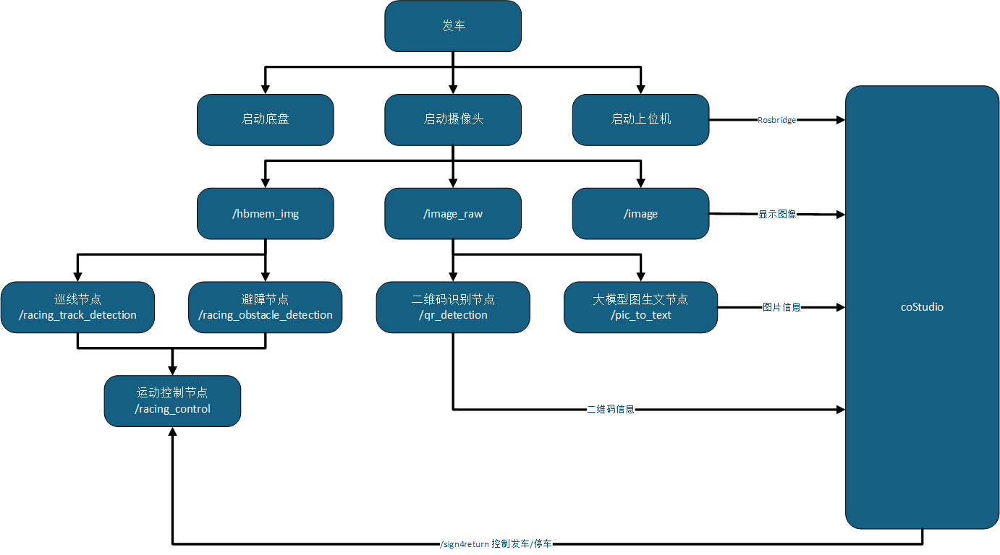

# 第二十届智能车竞赛 创意组（地瓜机器人）技术报告

**学校：** 杭州电子科技大学

**队伍名称：** 杭电地瓜机器人四队

**参赛队员：** 邢家伟、徐正一、盛智超、许卓涛

**指导老师：** 余善恩

## 摘要

针对第二十届智能车竞赛创意组（地瓜机器人）任务，基于地平线旭日 RDK X5 开发板的 Origin Car Pro 车模，本报告提出了一套高性能自主驾驶系统。系统以单目摄像头为唯一外部传感器，其核心是一种创新的多任务学习端到端控制模型。该模型在单一网络中集成了用于赛道中线预测的 ResNet-18 分支和用于锥桶/停车标志识别的 YOLO11n 分支，并由地平线 BPU 高效加速。该方案实现了从自主巡线、扫描二维码到终点精准停车的全流程闭环控制。经测试，系统平均圈速达30秒，展现出卓越的鲁棒性。算法层面，ResNet-18 与 YOLO11n 的量化后模型余弦相似度分别高达 99.86% 和 99.97%，在确保高精度的同时，验证了本端到端方案在提升决策实时性与准确性方面的显著优势。

## 1. 引言

### 1.1. 任务目标

根据第二十届全国大学生智能车竞赛创意组（地瓜机器人）的赛项要求，该系统的总体目标是在人机协同模式下，以最短的总时间高效、稳定地完成卫生消杀、巡检与信息采集的综合性任务。为实现上述目标，本系统需要完成以下三个核心子任务：

1. 自主任务领取：机器人需能够从指定发车点（P）出发，通过自主导航算法，精准、稳定地行驶至区域A内的任务发布点，成功获取并解析指定的二维码，完成任务1。
2. 遥控巡检与消毒：系统需无缝切换至遥操作模式，由操作员进行远程控制，根据任务指令规定的路线，在诊疗区内完成巡航，并实时记录沿途病人的状态信息，完成巡检任务后，机器人需准确返回至大厅入口，结束任务2。
3. 自主返航与交付：系统需再次切换回自主控制模式，机器人需能够从大厅入口自主规划路径，并安全、快速地返回至区域A的初始停车点（P），实现精准停泊，标志整个任务流程的结束。

综上所述，本系统需要综合运用自主路径规划与导航、环境感知、以及任务状态管理等多项技术，以应对赛项中自主与遥控模式的动态切换，并最终在速度和稳定性上取得优异表现。

### 1.2. 系统总体方案概述

本系统采用基于 ROS 的分布式、模块化软件架构，其总体方案如上图所示。系统启动后，车载摄像头作为主要传感器，采集原始图像数据。该数据流被分为三路：一路以地平线特有的 `hbmem_img` 格式发布，专供需要 BPU 硬件加速的高性能计算节点使用；一路以通用的 `/image_raw` 格式发布，供二维码识别节点和大模型图生文节点订阅；最后一路以压缩画质的 `/image` 格式发布，减少发布至上位机的数据大小。

其中， 巡线节点（ `/racing_track_detection` ）和避障节点（ `/racing_obstacle_detection` ）订阅高性能的 `/hbmem_img` 图像流，利用 BPU 进行加速推理，实时解算出赛道线信息和障碍物位置。二维码识别节点（ `/qr_detection` ）和大模型图生文节点（ `/pic_to_text` ）订阅原始图像流，分别负责识别场内二维码和解析特定图像信息，完成识别二维码和图生文任务。运动控制节点（ `/racing_control` ）作为决策与控制核心，订阅并融合来自巡线和避障节点的感知结果，通过内置的 PID 控制算法生成最终的转向和速度指令，驱动底盘运动，形成自主导航的闭环。 `coStudio` 作为上位机监控界面，通过 `Rosbridge` 与车载系统通信。它不仅能实时显示摄像头图像、二维码及图片信息，还可以通过`sign4return`信号控制机器人的启动与停车，实现人机协同作业。

### 1.3. 结构安排

本技术报告旨在系统性地阐述我们为完成竞赛任务所进行的全流程工作。报告首先在引言部分明确系统目标，概述总体技术方案与报告结构。核心章节将深入阐述基于 ROS 的模块化软件架构，详解巡线、避障、二维码识别、图生文、停车等关键感知节点的算法原理与模型部署，以及运动控制节点中控制逻辑的设计实现。随后，报告将重点展示方案的技术亮点与核心创新，特别是我团队提出的基于多任务学习的端到端控制模型，并分析其在提升决策实时性与准确性方面的优势。为验证系统性能，我们提供包括模型精度、量化性能及赛道圈速在内的详尽测试数据，以此对系统的有效性与鲁棒性进行定量与定性分析。最后，报告将对全部工作进行总结，重申成果贡献，客观分析当前方案的不足，并对未来优化方向进行展望，以期全面清晰地展现我们在本届智能车竞赛中的技术探索与实践成果。

## 2. 软件系统架构与算法实现

### 2.1. 控制算法

此代码库构建了一个多功能机器人平台的核心控制算法，其设计围绕 FreeRTOS ，以高频次精确地驱动和管理机器人的运动。整个控制系统以 `Balance_task` 任务为核心，该任务以100Hz的频率运行，确保了对机器人姿态和速度的实时控制。在每个控制周期中，系统首先读取并处理来自各电机编码器的原始数据，这些数据经过极性校正和单位转换，为后续的速度闭环控制提供了精确的实时反馈。

命令输入层允许机器人通过 CAN 总线接收运动指令，CAN总线直接传入的三轴目标速度。这些输入模块不仅解析原始指令，还会进行必要的死区处理、数据映射和单位转换，将不同控制器的输入统一转化为机器人 X、Y 方向上的线速度和Z轴上的角速度，并最终传递给运动学解算模块。

在每个控制周期中，控制流程会优先处理输入指令中 `Vz` 的含义。不同于麦克纳姆轮或全向轮小车中 `Vz` 直接代表车辆的旋转角速度，对于阿克曼车，它被重新定义为前轮的期望转向角度。进入 `Drive_Motor()` 函数后，阿克曼模式下的运动学逆解逻辑被激活。此时，输入的 `Vx` 代表车辆的纵向速度，而经过预处理的 `Vz`  则用于计算前轮的转向。首先，`AngleR` 会确保转向角度在物理可行且安全的范围内，基于这个转向角度、车辆的轴距和轮距，系统会计算出车辆的瞬时转弯半径，这一步运用了阿克曼转向几何的核心原理：
$$
R = \frac{\text{Axle\_spacing}}{\tan(\text{AngleR})} - 0.5f \cdot \text{Wheel\_spacing}
$$
接下来，根据整体纵向速度和计算出的转弯半径，左右两个驱动轮的目标速度会被精确分解。当 `AngleR` 非零时，左右轮的目标速度会存在差异，内侧车轮需保持较低速度，外侧车轮则需保持较高速度，以实现平滑的差速转弯。若 `AngleR` 为零（直行），则两驱动轮的目标速度均简单地等于 `Vx`。阿克曼小车的另一个关键特性是其前轮的转向通过一个舵机实现。`Drive_Motor()` 函数在这里承担了驱动舵机的任务，它通过一个预定义的非线性多项式函数将计算出的 `AngleR` 转换为舵机的实际控制角度值（ `Angle_Servo` ），进而与 `SERVO_INIT` 以及一个比例因子结合，生成最终的舵机 PWM 值。这个舵机 PWM 值同样会进行限制，以防止超出行程。得到左右驱动轮的目标速度后，系统进入速度闭环控制阶段。`Incremental_PI_A` 和 `Incremental_PI_B` 这两个独立的增量式 PI 控制器被调用，它们分别负责两个电机的速度控制。每个 PI 控制器会持续地获取对应驱动轮来自编码器的实时速度反馈，并与 `Drive_Motor()` 计算出的目标速度进行比较，生成速度偏差。然后，基于比例和积分项，计算出驱动电机所需的 PWM 增量。这些增量累加到当前的 PWM 输出值上，驱动电机调整其转速，力求使实际速度紧密地跟踪目标速度，从而实现对阿克曼小车精确的直线行驶和转弯控制。

最后，`Set_Pwm()` 函数负责将最终计算出的 PWM 值下发至硬件。对于阿克曼小车，它会将 `MOTOR_A.Motor_Pwm` 和 `MOTOR_B.Motor_Pwm` 经过正反转逻辑处理后输出给相应的 PWM 通道，同时将之前计算好的舵机PWM值 `Servo` 直接赋给 `Servo_PWM` 寄存器，完成对前轮转向的控制。而 `MOTOR_C` 和 `MOTOR_D` 的PWM输出则被设置为固定的非驱动值。此外，整个系统通用的安全机制也集成到阿克曼小车的控制中。`Turn_Off()` 函数能够实时监控电池电压和使能开关状态，在异常情况下立即停止所有电机 PWM 输出。而 `robot_mode_check()` 函数则作为一道额外的保险，持续监测驱动轮的PWM输出，一旦发现连续的异常大PWM值，便判断为“狂转”并紧急停机，进一步保障了阿克曼小车的运行安全。

### 2.2. 感知算法

#### 2.2.1. 基于 ResNet-18 的中线循迹

中线循迹的核心感知算法采用了一个基于 ResNet-18 深度学习模型的方案，以实现对赛道中线的精准循迹。该算法可持续处理输入的图像流，并输出赛道中心点的坐标和置信度，为后续的决策与控制模块提供关键依据。在具体的算法流程中，系统首先对车载摄像头传入的原始图像（640x480）进行预处理。为了专注于车辆前方的关键区域并满足模型对输入尺寸的要求，算法会从原始图像的底部裁剪出一个640x224像素的感兴趣区域（ ROI ）。这一裁剪操作能够有效地排除了地平线以上等无关信息的干扰。随后，该裁剪后的图像被缩放至224x224像素，并转换为适用于硬件加速推理的NV12格式，作为ResNet-18模型的最终输入。

经过优化的 ResNet-18 模型在地平线 BPU 的嵌入式计算平台上执行前向推理。传统循迹算法采用的是单一输出预测中线点的归一化坐标（x，y），在一些中线点低置信度情况下可能输出错误的预测坐标，而本模型的输出包含了预测的中线点的归一化坐标（x，y）以及一个置信度值，可以有效避免在后续决策中得到错误的预测坐标而发生无法正确巡线的状况。在后处理阶段，算法首先通过 Sigmoid 激活函数将模型的原始置信度输出转换为0到1之间的概率值。接着，它对归一化的坐标点进行反归一化计算，将其从模型的输出空间 [-1, 1] 还原至裁剪区域（640x224）的像素坐标系。最后，通过将Y坐标加上裁剪时的垂直偏移量，该点被精确地映射回原始图像的完整坐标系中。最终，包含这个中心点坐标和置信度的感知结果被封装成 `PerceptionTargets` 的消息进行发布，实现了从图像到赛道中线位置的端到端感知。此外，该算法还设计了外部开关，可通过订阅特定 ROS 话题来动态启用或禁用循迹功能，增强了系统的灵活性和可控性。

#### 2.2.2. 基于 YOLO11 的障碍物、终点检测

在感知算法中，基于 YOLO11 的障碍物与终点线检测是确保安全与完成比赛任务的核心环节。该算法库通过高效的深度学习模型和优化的处理流程，实现了在嵌入式硬件上对赛道环境的实时、精准感知。整个流程从图像数据采集、预处理，到模型推理，再到后处理与结果发布，构成了一个完整且高效的检测系统。该系统的核心是经过优化的 YOLO11 模型，该模型以其在速度和精度上的出色平衡性而被选用，同时也可向下兼容 YOLOv8 系列的检测模型。 

为了将高性能的 YOLO11 模型部署到嵌入式设备上，我们进行了一系列离线处理。初始的 PyTorch 模型首先经过结构性调整，主要修改了其检测头（ Detect Head ）的 `forward` 方法，将原本混合输出的预测结果分解为独立的分类和边界框信息流，形成了六个独立的输出张量，这为后续在 BPU 上的并行处理和优化提供了便利。修改后的模型被导出为通用的 ONNX 格式。随后，我们采用了训练后量化（ PTQ ）方案，利用少量校准数据集，通过地平线的 Open Explorer 工具链将模型从 FP32 运算转换为定点 INT8 运算。这一步显著降低了模型的计算复杂度和内存占用。在此基础上，我们还进行了一项核心优化：使用 `hb_model_modifier` 工具移除了三个边界框输出头的反量化节点。这意味着，编译后的最终模型将直接输出整型的边界框预测原始值，而反量化所需的缩放系数则作为元数据存储在模型内部，交由运行时的后处理代码进行手动解码。这种设计避免了在 BPU 上执行额外的反量化操作，进一步压榨了硬件性能，使得整个模型在BPU上以单一且高效的计算图运行。

在接收到原始图像数据后，系统首先进行预处理，为了适应 YOLO11 模型固定的输入尺寸（640x640），采用了 `letterbox` 技术对图像进行缩放和填充。该方法能够在不扭曲图像内容的前提下，将原始图像调整至目标尺寸，保持了原始图像的长宽比，这对于维持物体形态、保证检测精度至关重要。同时，填充区域也使得后续从模型输出坐标到原始图像坐标的反算过程更为简便。

预处理后的图像数据被送入 BPU 进行模型推理。推理完成后，进入后处理阶段，这一阶段的目标是将在三个不同尺度特征图上得到的原始预测解码为有意义的边界框。处理过程首先通过计算反函数并利用其单调性，高效地过滤掉大量置信度低于预设阈值的预测。对于通过初步筛选的预测，系统会进一步进行分布式焦点损失的解码计算，将模型输出的概率分布转换为精确的边界框坐标。完成坐标解码后，系统会对每个检测类别独立执行非极大值抑制算法。 NMS 通过计算候选框之间的交并比，有效剔除了对同一目标的冗余、重叠的检测框，最终为每个被检测到的物体保留一个最优的边界框。 在完成 NMS 后，系统会将最终检测结果的坐标从模型输入尺寸转换回原始图像尺寸，从而得到障碍物或停车标志在摄像机原始视野中的精确位置。

最后，整个检测流程被封装在 ROS 节点中，该节点通过订阅图像话题来获取实时视频流，在每帧图像上执行上述完整的检测流程，并将最终识别出的障碍物和停车标志的位置、类别及置信度信息，以自定义的 `PerceptionTargets` 消息格式发布出去，供决策和控制模块使用。

#### 2.2.3. 基于 PyZbar 的二维码识别

为了通过任务发布点的二维码获得信息，我们基于 OpenCV 的图像处理及配套的开源 PyZbar 库，实现了二维码的动态识别与信息转换。由于该任务是子任务一中的一个小目标，需要匹配其他通信接口。在这个部分代码内通过订阅话题获取二维码识别节点是否激活的指令，同时在识别后反馈信号，实现识别完成后的小车巡线状态的暂停。最关键的图像处理部分是通过接收相机节点发布的 `/image` 信息后，通过 ROS 内置的转换库，将图像交由 OpenCV 处理，配合 PyZbar 库即时处理二维码信息，得到小车进入任务二的运动方向指令。最后，通过 ROS 话题通信实现与数字环境的即时通信。

#### 2.2.4. 基于千问 VL-Plus 的图生文

该部分实现了一个基于 ROS 的图生文算法节点，其核心功能是利用阿里云通义千问的 VL-Plus 多模态模型，将接收到的图像转换为详细的文本描述。该节点订阅了名为`/image_compressed`的压缩图像话题，旨在接收来自机器人或其他视觉传感器发布的图像数据。在接收到图像后，节点会利用 `CvBridge` 和 `OpenCV` 库，将压缩图像消息解码为可在 Python 中处理的 OpenCV 图像格式。为了与通义千问 VLLM API 的接口规范兼容，解码后的图像会被进一步编码为 Base64 字符串。值得注意的是，该节点设计为通过使用线程锁机制来确保只对接收到的第一张图像进行处理，防止资源浪费和重复推理。一旦该图像被锁定并进入处理流程，后续到达的图像将不再被处理。图像的 Base64 编码完成后，节点会通过一个 OpenAI 兼容模式客户端调用通义千问 VL-Plus 模型进行图生文推理。API调用采用非流式模式，这意味着节点将等待模型返回完整的文本描述，而非逐字接收，从而提高结果获取的即时性和完整性。成功获取到模型返回的文本描述后，节点会通过 ROS 日志系统输出完整回复。完成文本输出后，节点会启动一个定时器，并在短暂延迟后触发 `shutdown_node` 方法，实现资源的释放与自动退出，在完成单次图像处理任务后便关闭节点。

### 2.3. 决策规划

